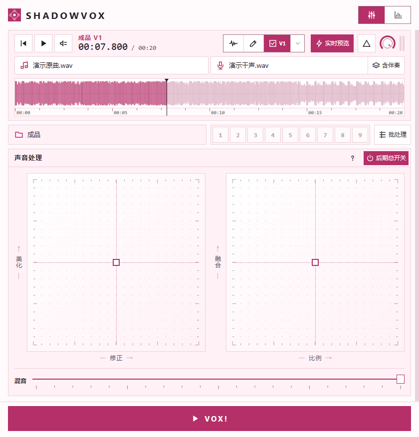

<p align="center">
  
</p>

<h1 align="center">ShadowVox</h1>

<p align="center">跟着原唱修音，把自己的演唱混进伴奏。</p>

<p align="center">
  <a href="https://github.com/AngleNaris/ShadowVox/releases/latest"></a>
  
  
</p>

<p align="center">
  <a href="https://github.com/AngleNaris/ShadowVox/releases/latest"><strong>下载 Windows 版</strong></a>
  &nbsp;·&nbsp;
  <a href="#快速开始">快速开始</a>
  &nbsp;·&nbsp;
  <a href="#从源码运行">从源码运行</a>
</p>

<p align="center">
  
</p>

---

## 这是什么

ShadowVox 是一个本地运行的中文歌声修音工作台。把演唱干声和带原唱的原曲导入同一个窗口，软件会从原曲分离伴奏，以原唱为参考校正节奏和音高，再将你的演唱混进伴奏。处理在本机完成，录音无需上传。

<table>
  <tr>
    <td width="33%" valign="top"><b>干声清理</b><br>分离录音中混入的伴奏，修复明显削波并减轻底噪。</td>
    <td width="33%" valign="top"><b>修音与对齐</b><br>按中文唱词匹配进点，支持跨八度跟唱，使用 Signalsmith Stretch 渲染音高和节奏。</td>
    <td width="33%" valign="top"><b>混音与母带</b><br>调人声比例、音色和空间感。伴奏在人声活动时做中频避让，成品统一校准响度和真峰值。</td>
  </tr>
  <tr>
    <td valign="top"><b>同位置试听</b><br>在修音前、局部草稿和成品之间切换。需要对比听感时可开启等响试听。</td>
    <td valign="top"><b>批量与版本</b><br>多条干音可共用原曲，也可逐条配对。每次导出保存独立版本。</td>
    <td valign="top"><b>可视化报告</b><br>查看音准、入点、频谱与声场变化。HTML 可离线打开，图表可导出 PNG。</td>
  </tr>
</table>

## 快速开始

Windows 10／11 x64 用户可从 [GitHub Release](https://github.com/AngleNaris/ShadowVox/releases/latest) 下载便携版。v9.5.1 提供 `.7z.001` 至 `.7z.004` 四个分卷。放到同一目录后，用 7-Zip 打开 `.001` 解压，再运行 `ShadowVox-9.5.1.exe`。同页的 `.sha256` 文件可用于校验解压后的 EXE。

1. 选择带原唱的原曲和自己的演唱干声。干声混入伴奏时，打开「含伴奏」。
2. 选好输出目录，按需调整修正、美化、融合、比例和混音，点击 **VOX!**。
3. 在播放器对比处理前和成品，在报告页查看变化。输出目录会保存 WAV 和离线报告。

## 从源码运行

准备 Windows x64、Python 3.13，以及带 C++ 桌面开发组件的 Visual Studio Build Tools。模型、FFmpeg、降噪组件和 ZL 插件需另行准备，来源和版本见[第三方组件说明](./THIRD_PARTY.txt)。

```powershell
python -m pip install -r requirements-desktop.txt
python tools/build_signalsmith.py
python desktop.py
```

单曲和批量 CLI 使用与桌面版相同的参数映射，输出版本化 WAV 和报告。

```powershell
python run.py desktop --help
python run.py batch --help
```

更多用法见[桌面与 CLI 文档](./docs/desktop-v1.md#gui-与-cli-覆盖核对)。

## 许可与第三方组件

仓库目前尚未指定统一的项目许可证。各组件、模型权重的许可和分发说明见[第三方组件说明](./THIRD_PARTY.txt)。

作者 **繁星之子卡萨蒂亚**。
