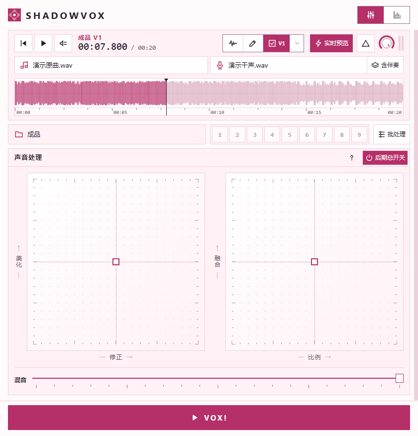

<p align="center">
  
</p>

<h1 align="center">ShadowVox</h1>

<p align="center">跟着原唱修音，把自己的演唱混进伴奏。</p>

<p align="center">
  <a href="https://github.com/AngleNaris/ShadowVox/releases/latest"></a>
  
  
  <a href="./LICENSE"></a>
</p>

<p align="center">
  <a href="https://github.com/AngleNaris/ShadowVox/releases/latest"><strong>下载 Windows 版</strong></a>
  &nbsp;·&nbsp;
  <a href="#快速开始">快速开始</a>
  &nbsp;·&nbsp;
  <a href="#从源码运行">从源码运行</a>
  &nbsp;·&nbsp;
  <a href="#文档导航">开发文档</a>
</p>

<p align="center">
  
</p>

---

## 这是什么

ShadowVox 是一个本地运行的中文歌声修音工作台（当前源码版本 `9.6.0`）。把演唱干声和带原唱的原曲导入同一个窗口，软件会从原曲分离伴奏，以原唱为参考校正节奏和音高，再将你的演唱混进伴奏。处理在本机完成，录音无需上传。

<table>
  <tr>
    <td width="33%" valign="top"><b>干声清理</b><br>分离录音中混入的伴奏，修复明显削波并减轻底噪。</td>
    <td width="33%" valign="top"><b>修音与对齐</b><br>按中文唱词（支持可选 `.lrc`）匹配进点，支持跨八度跟唱，使用 Signalsmith Stretch 渲染音高和节奏。</td>
    <td width="33%" valign="top"><b>混音与母带</b><br>内置 8 套曲风预设与可调推子。伴奏在人声活动时做中频避让，成品统一校准响度和真峰值。</td>
  </tr>
  <tr>
    <td valign="top"><b>同位置试听</b><br>在修音前、局部草稿和成品之间切换。需要对比听感时可开启等响试听。</td>
    <td valign="top"><b>批量与分轨</b><br>多条干音可共用原曲或逐条配对，支持导入/导出独立分轨。每次导出保存独立版本。</td>
    <td valign="top"><b>可视化报告</b><br>查看音准、入点、频谱与声场变化。HTML 可离线打开，图表可导出 PNG。</td>
  </tr>
</table>

## 快速开始

Windows 10／11 x64 用户可从 [GitHub Release](https://github.com/AngleNaris/ShadowVox/releases/latest) 下载单文件便携版（如提供分卷 `.7z.001`…，放到同一目录后用 7-Zip 打开 `.001` 解压运行）。同页的 `.sha256` 文件可用于校验解压后的 EXE。

1. 选择带原唱的原曲和自己的演唱干声。干声混入伴奏时，打开「含伴奏」。
2. 选好输出目录，按需调整修正、美化、融合、比例和混音（或直接套用曲风预设），点击 **VOX!**。
3. 在播放器对比处理前和成品，在报告页查看变化。输出目录会保存 WAV 和离线报告。

可在「原曲」旁选择或拖入同一版本的 `.lrc`。逐行歌词帮助定位原唱字句，软件仍根据音频确定字头。更换原曲会清除已选歌词。歌词无法读取或匹配证据不足时自动回退，报告会显示实际使用情况。

「设置 → 保存选项」可为单曲和批量额外保存原唱人声、原曲伴奏，以及保留人声效果的处理后独立轨。额外音轨与成品使用同一版本号。处理后人声与成品对齐，包含混响和延时。全曲母带作用于成品。

工作台的「曲风」菜单提供抒情流行、主流流行、民谣、摇滚、R&B、中国风、舞曲、说唱。应用后可用工作台控件调整，再从菜单选择「保存当前参数」或「恢复初始值」。

## 从源码运行

### 前置系统工具

- **Windows 10 / 11 x64**
- **Python 3.13**（主程序运行与打包环境）
- **FFmpeg**（推荐 `winget install Gyan.FFmpeg`，打包时需要随附 `LICENSE`）
- **Visual Studio Build Tools**（勾选「使用 C++ 的桌面开发」，用于编译 Signalsmith 渲染助手）
- **Python 3.12**（用于构建独立的 DeepFilterNet3 AI 降噪子程序；若直接拷贝离线依赖包则无需安装）

### 安装依赖与一键补齐

除上述系统工具外，离线 AI 模型、ZL VST3 插件、Signalsmith 渲染助手和 DeepFilterNet3 降噪助手均可通过仓库脚本自动补齐：

```powershell
# 1. 创建 Python 3.13 虚拟环境并安装依赖（推荐先装 CPU 版 PyTorch 控制体积）
py -3.13 -m venv .venv
.venv\Scripts\python.exe -m pip install --upgrade pip
.venv\Scripts\python.exe -m pip install --extra-index-url https://download.pytorch.org/whl/cpu torch
.venv\Scripts\python.exe -m pip install --extra-index-url https://download.pytorch.org/whl/cpu -r requirements-desktop.txt

# 2. 自动补齐离线模型、ZL VST3 插件、Signalsmith 助手与降噪助手
.venv\Scripts\python.exe tools\setup_env.py --install

# 3. 核对全部运行与打包依赖状态
.venv\Scripts\python.exe tools\setup_env.py --check

# 4. 启动桌面工作台
.venv\Scripts\python.exe desktop.py
```

详细依赖矩阵、SHA-256 校验值及内网离线交接打包方式见[依赖清单与自动补齐说明](./docs/DEPENDENCIES.md)。

### 命令行用法

```powershell
# 单曲（与桌面工作台相同参数映射与版本化输出）
python run.py desktop 干音.wav 原曲.wav --lyrics 原曲.lrc -o out

# 导入已有分轨（跳过原曲分离，原唱和伴奏须同一起点）
python run.py desktop 干音.wav --reference-vocal 原唱人声.wav --instrumental 伴奏.wav -o out
python run.py batch 干音1.wav 干音2.wav --reference-vocal 原唱人声.wav --instrumental 伴奏.wav -o out

# 查看全部参数
python run.py desktop --help
python run.py batch --help
```

`batch --manifest` 的每条记录可用 `reference_vocal` 和 `instrumental` 指定参考分轨，或用 `song` 指定原曲。基础入口 `python run.py 干音.wav` 也可以搭配这两个分轨参数。更多用法见[桌面与 CLI 文档](./docs/desktop-v1.md#gui-与-cli-覆盖核对)。

## 文档导航

- **[开发者交接与维护指南](./docs/DEVELOPER.md)**：系统架构、模块地图、测试体系、单文件打包与发布验收流程、交接待决事项。
- **[依赖清单与自动补齐说明](./docs/DEPENDENCIES.md)**：Git 内置 / 脚本自动补齐 / 系统安装依赖全景表与离线交接方案。
- **[音频处理流程图解](./docs/algorithm.html)**：本地浏览器可打开的可视化处理链路说明。
- **[版本实施与验收记录](./docs/desktop-v1.md)**：历史版本迭代、算法边界与验收数据记录。
- **[第三方组件与许可说明](./THIRD_PARTY.txt)**：模型权重、运行时和音频插件的来源与许可约束。

## 许可与第三方组件

ShadowVox 本项目源代码采用 **[GNU Affero General Public License v3.0 (AGPL-3.0)](./LICENSE)** 开源许可。

> **重要说明（代码许可与第三方模型权重分离）**：
> - `LICENSE`（AGPL-3.0）仅适用于 ShadowVox 本项目的原创源代码，符合项目进程内集成的强传染性开源组件（`ZL Compressor / ZL Limiter` 的 AGPL-3.0、`Pedalboard / Parselmouth` 的 GPL-3.0，经双方第 13 条兼容组合）以及 `PySide6`（LGPL-3.0）、`HubertFA`（Apache-2.0）等开源协议要求。
> - 本项目所依赖的**第三方组件与预训练模型权重各自独立适用其原始许可**，不受本项目 AGPL-3.0 覆盖；其中包含带非商业限制的 `PC-NSF-HiFiGAN` 权重（CC BY-NC-SA 4.0）以及再分发授权待上游确认的 `DeepFilterNet3` 权重。如需公开发布整合包或商用，请务必先行核对[第三方组件说明](./THIRD_PARTY.txt)。

版权所有 © 2026 **繁星之子卡萨蒂亚**。
