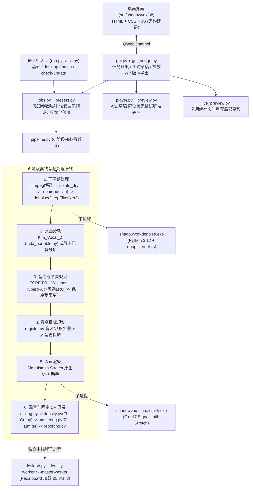

# ShadowVox 开发者交接与维护指南

本文档面向接手维护和二次开发 ShadowVox 的开发者，系统介绍项目现状、整体架构、代码目录、本地开发与调试、测试验收、单文件发布以及交接注意事项。

- **当前版本**：`9.6.0`（定义于 [src/shadowvox/\_\_init\_\_.py](../src/shadowvox/__init__.py)）
- **目标平台**：Windows 10 / 11 x64（本地离线运行，不上传音频）
- **核心技术栈**：Python 3.13、PySide6 + QtWebEngine + QWebChannel、ONNX Runtime (DirectML/CPU)、PyTorch (CPU, Whisper)、Numba、Pedalboard (VST3)、Signalsmith Stretch (C++17)、DeepFilterNet3 (Python 3.12 独立进程)、FFmpeg
- **相关文档**：
  - [依赖清单与自动补齐说明](./DEPENDENCIES.md)
  - [音频处理流程图解（交互式 HTML）](./algorithm.html)
  - [版本实施与验收记录](./desktop-v1.md)
  - [第三方组件与许可说明](../THIRD_PARTY.txt)

---

## 一、系统架构总览

ShadowVox 采用「**桌面 WebView 壳 + Python 离线 DSP/AI 管线 + 隔离原生/VST3 子进程**」架构，前端无需 Node.js / npm 构建工具，直接由 QtWebEngine 加载本地静态 HTML/CSS/JS。



### 几个关键设计约定

1. **为什么 VST3 渲染必须走独立子进程（`vst_worker.py`）**：
   Pedalboard 宿主加载 Windows VST3（ZL Compressor / ZL Limiter）在 Qt 后台工作线程中存在线程安全与 COM/GUI 初始化问题。当 `density.py` 或 `mastering.py` 检测到当前不在主线程时，会通过 `vst_worker.py` 拉起 `desktop.py --density-worker` / `--master-worker` 子进程（打包后复用同一主 EXE）在其主线程完成离线渲染。
2. **为什么降噪单独做成 Python 3.12 EXE（`shadowvox-denoise.exe`）**：
   `deepfilternet-rs 0.1.1` 仅支持 Python 3.10–3.12，而主程序与 PySide6 6.12 使用 Python 3.13。通过 `denoise.py` 传入 48 kHz float32 NPY 文件调用独立 EXE，既解耦了 Python 版本，也让单文件 EXE 零依赖运行。注意调用子进程前需设置 `PYINSTALLER_RESET_ENVIRONMENT=1`。
3. **开发态与单文件 EXE 路径约定（`config.py`）**：
   - **源码运行**：`ROOT = 仓库根目录`，`DATA_ROOT = 仓库根目录`（输出写到 `out/`，缓存写到 `work/`，WebView 配置写到 `webview-storage/`）。
   - **打包 EXE 运行**：`ROOT = Path(sys._MEIPASS)`（只读解包目录），`DATA_ROOT = %LOCALAPPDATA%\ShadowVox`（可写用户数据目录；首次启动会自动迁移旧名 `%LOCALAPPDATA%\Atune`）。
4. **单文件 EXE 的多用途入口（`desktop.py`）**：
   同一个 `ShadowVox-<ver>.exe` 根据命令行参数承担 5 种角色：
   - 无参数：启动 QtWebEngine 桌面工作台。
   - `--density-worker <dir>` / `--master-worker <dir>`：内部 VST3 离线程工作进程。
   - `--plugin-editor <vst3> <state> <errlog>`：独立进程打开第三方 VST3 原生编辑器并保存/恢复状态。
   - `--process <request.json>`：无界面全流程处理（供 `verify_release.py` 验收）。
   - `--gui-check <out_dir>`：原生窗口与报告导出自动验收。

---

## 二、目录结构与核心模块地图

### 顶层目录

```text
.
├── desktop.py                       # 桌面主入口与单 EXE 内部子进程/验收分发
├── run.py                           # CLI 入口（转发至 shadowvox.cli.main）
├── shadowvox.cmd                    # Windows 快捷批处理封装（调用 .venv\Scripts\python.exe run.py）
├── ShadowVox.spec                   # PyInstaller 单文件打包配置
├── requirements.txt                 # 核心音频/推理 Python 依赖
├── requirements-desktop.txt         # 桌面 UI + 打包完整 Python 依赖
├── requirements-denoise-helper.txt  # Python 3.12 降噪子程序构建依赖
├── THIRD_PARTY.txt                  # 第三方组件、模型来源与许可清单
├── TODO.md                          # 历史迭代与开发任务日志
├── assets/                          # 应用图标 (.ico / .png)
├── docs/                            # 文档与处理流程图解
├── src/shadowvox/                   # 核心源码包
├── tools/                           # 依赖拉取、编译、打包、测试与研究脚本
├── models/                          # [被 git 忽略] 离线 AI 模型（由 tools/fetch_models.py 补齐）
├── plugins/                         # [被 git 忽略] ZL VST3 插件（由 tools/fetch_zl.py 补齐）
└── tools/vendor/                    # [被 git 忽略] 编译/打包产物（Signalsmith / DeepFilterNet / 可选 RubberBand）
```

### 核心源码模块（`src/shadowvox/`）

| 分类 | 模块 | 职责说明 |
| --- | --- | --- |
| **基础与配置** | `__init__.py` | 版本号 `__version__`、作者 `AUTHOR`、GitHub 仓库 `GITHUB_REPO` |
| | `config.py` | 路径常量（源码/冻结态自适应）、采样率与模型路径、CPU_ONLY 开关 |
| | `audio.py` | 统一 FFmpeg 音频解码、WAV 保存、RMS/峰值/包络工具 |
| | `updates.py` | 手动检查 GitHub Releases 最新正式版 |
| **入口与任务** | `cli.py` | CLI 入口（基础命令、`desktop`、`batch`、`check-update`） |
| | `jobs.py` | 桌面五轴感知参数映射 (`options_from`)、版本化导出 (`_V1`, `_V2`...)、串行批处理 |
| | `presets.py` | 8 套独立曲风预设（抒情流行、主流流行、民谣、摇滚、R&B、中国风、舞曲、说唱） |
| | `pipeline.py` | 6 阶段主处理流程编排 (`Options`, `run`, `validate_reference`) |
| **干声清理与分离** | `separate.py` | 分离调度与干声分离缓存 (`isolate_dry`, `separate_song`) |
| | `mdx_portable.py` | Kim Vocal 2 轻量 ONNX 推理（STFT/ISTFT + 重叠相加，不依赖 PyTorch/audio-separator） |
| | `repair.py` | 基于 FFmpeg `adeclip` 的明显数字削波修复 |
| | `denoise.py` | 44.1k↔48k 多相重采样 + 调用 `shadowvox-denoise.exe` (DeepFilterNet3 温和档) |
| | `vocal_gate.py` | 按原唱唱段对齐后的空档平滑静音门 |
| **音高、节奏与对齐** | `f0.py` | FCPE 100 fps 音高提取 (ONNX + 质心解码) |
| | `mel.py` | Slaney 梅尔滤波器组与对数幅度谱 |
| | `lyric_anchors.py` | LRC 歌词解析 (`read_lrc`) 与本地 Whisper 离线粗锚点 |
| | `hubert_alignment.py` | 默认中文歌声对齐引擎：Whisper 识别 + HubertFA 音素定位 + 保序匹配 + 受限变时 |
| | `full_align.py` | 保守整句对齐框架（保护原声顺序、完整性与连续性） |
| | `rhythm.py` / `guarded_rhythm.py` | 起音级全局延迟估计与历史有限节奏对照模块 |
| | `align.py` | 干声↔原唱时间对齐、音高映射与大音差边界处理 |
| | `register.py` | 乐句/持续音区八度折叠、去颤音音高中心修正与 300 音分大音差保护 |
| | `natural.py` | 实验性音符中心分段辅助函数 |
| **人声渲染** | `signalsmith.py` | **默认渲染器**：调用 `shadowvox-signalsmith.exe` 完成音高移调与受限变时（含平滑与共振峰追踪） |
| | `vocoder.py` | 历史/实验声码器渲染（PC-NSF-HiFiGAN ONNX） |
| | `psola.py` | 历史/实验 TD-PSOLA 渲染（Praat / parselmouth） |
| | `rubberband.py` | 历史对照渲染（Rubber Band R3 CLI，非默认） |
| **混音、母带与 VST3** | `mixing.py` | 人声 EQ/压缩/去齿/谐波/混响/延时 + 250–4000 Hz 中频伴奏避让 |
| | `mix_balance.py` | 慢速离线人声-伴奏电平自动平衡 |
| | `density.py` | ZL Compressor 0.6.1 四段 Optical 母带密度压缩 |
| | `mastering.py` | 固定 C+ 母带终结器（段落塑形 + ZL Limiter 0.0.1 4x 真峰值限幅 + 回读验证） |
| | `vst_host.py` / `vst_worker.py` | 第三方 VST3 原生编辑器宿主与独立主线程离线渲染进程 |
| **桌面 UI、试听与报告** | `gui.py` | `QMainWindow` + `DropView` (拖放拦截) + `QWebEngineView` + `QWebChannel` |
| | `gui_bridge.py` | 前后端桥接 (`Bridge` / `Worker`)：任务、批处理、实时草稿、波形、预设、设置、导出 PNG |
| | `live_preview.py` | 复用已分析素材在播放位置附近快速重算局部草稿 |
| | `player.py` / `preview.py` | 基于 `sounddevice` 的单输出流 A/B/草稿同位置切换播放器与可选等响匹配 |
| | `reporting.py` / `report_analysis.py` | 响度/真峰值/音准/入点/频谱/声场测量，生成 JSON、桌面报告数据与离线 HTML |
| **前端静态文件** | `ui/index.html`, `app.js`, `style.css`, `theme.js`, `report.js`, `report.css`, `logo.png` | 无框架纯原生 Web UI，含浅/深色主题、波形绘制、工作台控件与报告图表导出 PNG |

---

## 三、从零搭建开发环境

完整依赖来源与校验值见 [DEPENDENCIES.md](./DEPENDENCIES.md)。新开发机标准初始化流程：

### 1. 预装系统工具（Windows 10/11 x64）

```powershell
# 1) 主程序 Python 3.13
winget install Python.Python.3.13

# 2) FFmpeg (Gyan full build，附带 LICENSE 供打包收集)
winget install Gyan.FFmpeg

# 3) 如需自行构建降噪子程序（无离线依赖包时），安装 Python 3.12
winget install Python.Python.3.12
```

另外安装 **Visual Studio Build Tools**，勾选「使用 C++ 的桌面开发」（用于编译 `shadowvox-signalsmith.exe`）。安装后重开终端使 PATH 生效。

### 2. 创建虚拟环境并安装 Python 依赖

```powershell
py -3.13 -m venv .venv
.venv\Scripts\python.exe -m pip install --upgrade pip
# 先装 CPU 版 PyTorch，避免拉取 2GB+ CUDA 版导致打包体积暴涨
.venv\Scripts\python.exe -m pip install --extra-index-url https://download.pytorch.org/whl/cpu torch
.venv\Scripts\python.exe -m pip install --extra-index-url https://download.pytorch.org/whl/cpu -r requirements-desktop.txt
```

### 3. 一键补齐全部模型、插件与原生助手

```powershell
# 自动下载 models/、plugins/ 并编译 Signalsmith（若检测到 Python 3.12 也会自动构建降噪助手）
.venv\Scripts\python.exe tools\setup_env.py --install

# 随时运行体检脚本核对环境
.venv\Scripts\python.exe tools\setup_env.py --check
```

也可以分步单独运行：

```powershell
.venv\Scripts\python.exe tools\fetch_models.py        # 下载并校验 5 个离线 AI 模型
.venv\Scripts\python.exe tools\fetch_zl.py            # 下载并提取 ZL Compressor / Limiter VST3
.venv\Scripts\python.exe tools\build_signalsmith.py   # 编译 shadowvox-signalsmith.exe
.venv\Scripts\python.exe tools\build_denoise.py       # 用 Python 3.12 构建 shadowvox-denoise.exe 及许可
```

### 4. 启动桌面版与命令行

```powershell
# 启动桌面工作台
.venv\Scripts\python.exe desktop.py

# 查看命令行帮助
.venv\Scripts\python.exe run.py --help
.venv\Scripts\python.exe run.py desktop --help
.venv\Scripts\python.exe run.py batch --help
```

### 常用调试环境变量

| 环境变量 | 作用 |
| --- | --- |
| `SHADOWVOX_CPU_ONLY=1` | 强制 ONNX Runtime 使用 `CPUExecutionProvider`，排查 DirectML 显卡驱动问题 |
| `SHADOWVOX_OFFLINE_TEST=1` | 在 `desktop.py` 中拦截非本机回环的 Python socket 连接，验证完全离线运行 |
| `SHADOWVOX_BUILD_SIGNALSMITH=<path>` | 打包时指定 `shadowvox-signalsmith.exe` 路径（`build_release.py` 自动设置） |

---

## 四、测试与验收体系

项目测试位于 `tools/` 目录，使用 Python 标准库 `unittest` 与独立脚本运行（不依赖 `pytest`）。

### 1. 可直接运行的核心单元测试（不依赖私有本地歌曲）

以下命令在完成依赖补齐后即可在任意新开发机运行：

```powershell
# 核心 DSP / 算法 / 参数 / 任务 / 报告回归
.venv\Scripts\python.exe -m unittest `
  tools/test_improvements.py `
  tools/test_jobs.py `
  tools/test_lyric_anchors.py `
  tools/test_hubert_alignment.py `
  tools/test_register.py `
  tools/test_naturalness.py `
  tools/test_pitch_correspondence.py `
  tools/test_partial_alignment.py `
  tools/test_psola_transitions.py `
  tools/test_desktop_audio.py `
  tools/test_dry_cleanup.py `
  tools/test_denoise_mix.py `
  tools/test_low_mid_duck.py `
  tools/test_mix_reference.py `
  tools/test_report_results.py `
  tools/test_studio.py

# 合成音频端到端自检（分离 -> 对齐 -> 修音 -> 混音）
.venv\Scripts\python.exe tools/selftest.py
```

### 2. 需要桌面图形会话的 UI 自动化测试

QtWebEngine 不支持无头 `offscreen` 模式，以下命令需在真实 Windows 桌面会话中运行：

```powershell
.venv\Scripts\python.exe tools/test_gui.py
.venv\Scripts\python.exe tools/test_compact_ui.py
```

### 3. 依赖本地私有素材或特定环境的测试（移交须知）

以下脚本包含早期开发时的本机路径或特定环境假设，运行前需按需提供自己的测试音频或修改参数：

| 脚本 | 外部依赖说明 |
| --- | --- |
| `tools/test_denoise_helper.py` | 直接 `import deepfilternet_rs`，需在 Python 3.12 降噪虚拟环境中运行 |
| `tools/test_full_align.py` | 顶部硬编码了本地测试音频路径 `D:\_0.Downloads\青花瓷-干声.mp3` |
| `tools/test_portable.py` | 读取 `out/qinghua.report.json` 与 `out/desktop_preview/pink_v3`（旧版单 EXE 验收脚本，已被 `verify_release.py` 替代） |
| `tools/test_report_gui.py` | 读取 `out/report_implementation_20261029/青花瓷_报告验证.report.json` |
| `tools/test_vst_gui.py` | 依赖本机安装的第三方插件 `C:\Program Files\Common Files\VST3\iZotope\RX 11 De-clip.vst3` |
| `tools/test_report_svg.js` | Node.js SVG 报告单元测试（可选） |

---

## 五、单文件打包与发布流程

### 1. 打包前检查

1. 递增 `src/shadowvox/__init__.py` 中的 `__version__`（`build_release.py` 禁止覆盖 `dist/` 下已有同版本正式包）。
2. 确保 `python tools/setup_env.py --check` 全部必需项为 `[OK]`，特别注意：
   - PyTorch 必须为 `+cpu` 版本（`+cu` 会导致包体膨胀）。
   - FFmpeg 目录附带 `LICENSE` 文件。
3. 正式构建要求 Git 工作区干净（所有源码修改已提交）；调试打包可加 `--candidate` 输出到 `out/releases/<version>/candidate/`。

### 2. 执行构建

```powershell
# 候选包（允许未提交改动，输出到 out/releases/<version>/candidate/）
.venv\Scripts\python.exe tools/build_release.py --candidate --clean

# 正式发布包（要求 Git 干净，输出到 dist/ShadowVox-<version>.exe）
.venv\Scripts\python.exe tools/build_release.py --clean
```

`build_release.py` 会自动完成：
- 重编当次 `shadowvox-signalsmith.exe`；
- 计算所有源码文件与外部二进制/模型的 SHA-256；
- 调用 PyInstaller 按 `ShadowVox.spec` 打包单文件 EXE（写入 Windows 版本属性、图标、全部模型、ZL 插件、FFmpeg、降噪助手和所有第三方许可文件）；
- 校验构建期间源码未变化，输出同目录 `.sha256` 与 `.release.json` 清单。

### 3. 隔离冷启动验收（推荐每次发布必跑）

准备一份包含真实测试干声与原曲的 `request.json`（示例：`{"dry": "path/to/dry.wav", "song": "path/to/song.mp3"}`），运行：

```powershell
.venv\Scripts\python.exe tools/verify_release.py `
  --exe dist\ShadowVox-9.6.0.exe `
  --request path\to\request.json `
  --out out\releases\9.6.0\verification
```

`verify_release.py` 会在**精简 PATH、隔离 `%LOCALAPPDATA%`、禁用外网 (`SHADOWVOX_OFFLINE_TEST=1`)** 下完成：
- 校验 EXE 内部 22 个核心模块字节码、7 个 UI 文件、模型与助手哈希与当前源码逐字节一致；
- 用源码与独立 EXE 分别跑同一音频，断言输出 44.1 kHz 立体声逐样本最大误差 `<= 2e-6`；
- 拉起独立 EXE 的原生桌面窗口 (`--gui-check`)，验证默认参数、报告页渲染与 1080×1440 PNG 导出。

### 4. `ShadowVox.spec` 关键打包坑点备忘

- **DLL 污染防护**：构建机 PATH 中的 Poppler / libheif / 其他工具常携带旧版 `msvcp140*.dll`、`vcruntime140*.dll` 或不兼容的 `icu*.dll`、`ucrtbase.dll`，会导致目标机 `QtCore` 导入失败。`ShadowVox.spec` 已主动收敛构建 `PATH`、统一替换为 PySide6 随包 VC 运行库，并剔除系统级 ICU/UCRT/api-ms-win DLL。**切勿随意删除这些过滤逻辑**，且每次调整 spec 后必须在干净 PATH 下做原生 GUI 验收。
- **单文件体积**：完整包约 1.1 GB（主要来自 `hubertfa` 415 MB + `whisper-base` 138 MB + PyTorch CPU + QtWebEngine Chromium + 其余 ONNX 模型）。发布 GitHub Release 时通常用 7-Zip 分卷（如 `7z a -v350m ShadowVox-9.6.0.7z ShadowVox-9.6.0.exe`）并附带 `.sha256`。

---

## 六、项目交接清单与待决事项

移交项目前请特别关注以下事项：

1. **项目开源许可与第三方权重边界**：
   - ShadowVox 本项目源码已采用 **[GNU AGPL-3.0](../LICENSE)**（与进程内集成的 `ZL Compressor / ZL Limiter` AGPL-3.0、`Pedalboard / Parselmouth` GPL-3.0 第 13 条兼容组合，`PySide6` LGPL-3.0 动态链接及 `HubertFA` Apache-2.0 均完全兼容）。若对外部署修改后的网络/云端服务，须按 AGPL-3.0 第 13 条提供对应源码。
   - **代码许可不覆盖第三方预训练模型权重**：随包组件包含 **CC BY-NC-SA 4.0（非商业）** 的 `PC-NSF-HiFiGAN` 权重，以及权重再分发授权待确认的组件，详情见 [THIRD_PARTY.txt](../THIRD_PARTY.txt)。
   - 若未来希望放宽至 `GPL-3.0`（取消网络服务源码披露要求），则必须先移除/替换进程内加载的 `ZL Compressor` 与 `ZL Limiter`（AGPL-3.0）；若希望改用宽松许可（MIT / Apache-2.0），则还需同时替换 `Pedalboard`、`Parselmouth` 等所有 GPL-3.0 库。
2. **DeepFilterNet3 权重再分发授权待定**：上游推理代码为 MIT/Apache-2.0，但预训练权重再分发授权仍待上游确认（见 `THIRD_PARTY.txt` 中引用的 Issue `#712`）。当前定位为本地非商业实验工具。
3. **非 Git 资产的移交**：
   - **代码与配置**：直接通过 Git 仓库移交即可（移交前检查 `git status`，避免把根目录下临时测试音频或个人工程目录纳入提交）。
   - **模型、插件与助手**：接收方既可联网运行 `tools/setup_env.py --install` 自动补齐，也可按 [DEPENDENCIES.md#三离线--受限网络交接方案](./DEPENDENCIES.md#三离线--受限网络交接方案) 直接拷入 3 个本地目录。
4. **本地工作区临时目录说明**（均已在 `.gitignore` 中排除，移交时无需提交）：
   - `.venv/`、`build/`、`dist/`、`out/`、`work/`、`webview-storage/`、`stringCache.dat`、`tools/_selftest/`、根目录测试音频等。
5. **版本更新源**：`src/shadowvox/__init__.py` 中的 `GITHUB_REPO = "AngleNaris/ShadowVox"` 被 `updates.py` 用于检查更新；如果项目迁移至新仓库，请同步修改该常量和 `README.md` 链接。
